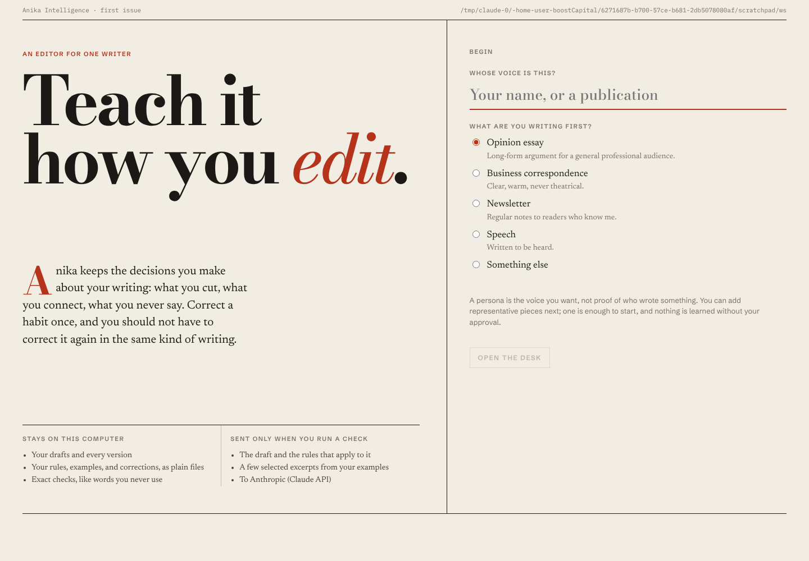
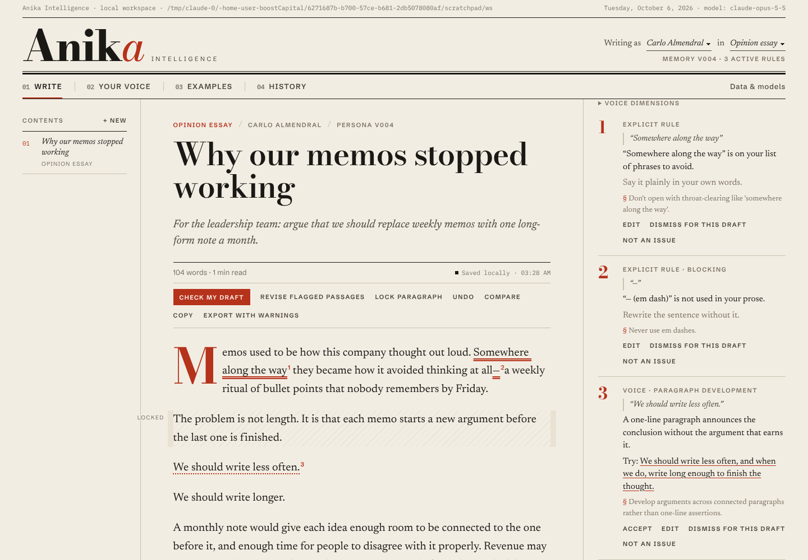
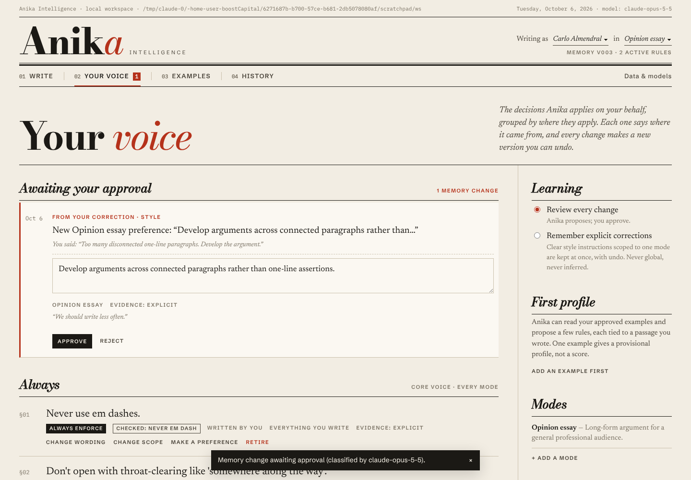
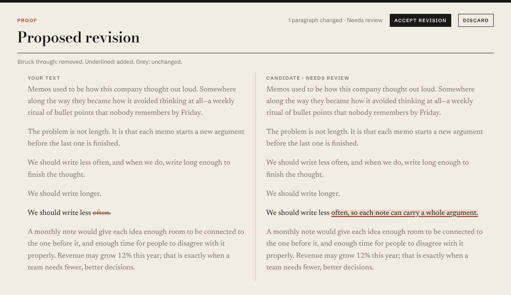
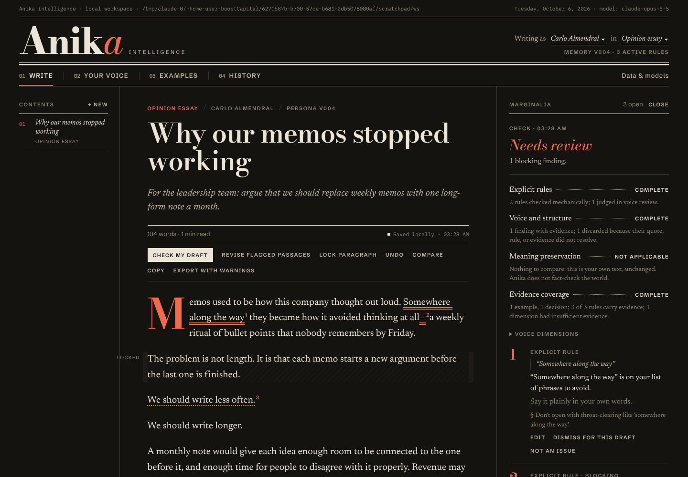
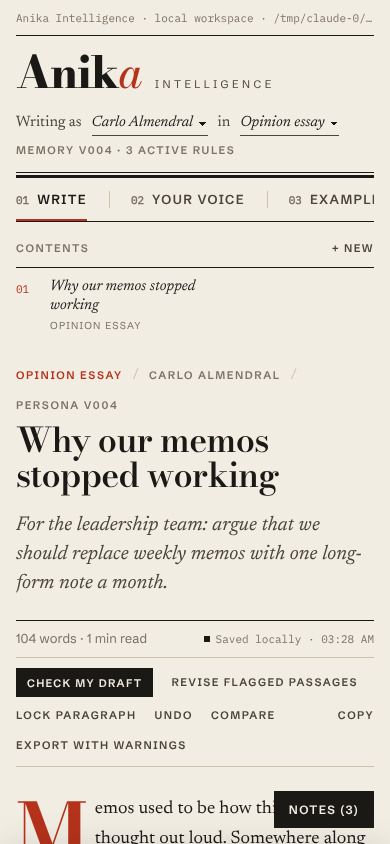

# Anika Intelligence

An editor that learns your editorial decisions, not just your adjectives.

This folder is a **web build of milestones M0 and M1** from the *Anika Intelligence PRD and Technical Specification v0.1*. It is a working local app: a React/Tiptap writing desk talking to a local Node service, which keeps human-readable persona memory in a folder you choose and calls Claude for the voice review, meaning review and revision stages.

It is **not** the packaged macOS/Tauri application the spec targets. The spec says a browser preview cannot prove native file access, crash recovery or credential storage (§27), and that still applies here.

## Run it

```bash
cd anika
npm install
cp .env.example .env            # optional: set ANTHROPIC_API_KEY
npm run build && npm start      # http://127.0.0.1:4317
# or, while developing:
npm run dev                     # UI on :5173, API on :4317
```

| Variable | Default | Purpose |
| --- | --- | --- |
| `ANTHROPIC_API_KEY` | unset | Enables voice review, meaning review, revision, profile suggestions, and feedback classification. Without it the app still edits, saves, versions, and runs exact checks; model stages say **unavailable**. |
| `ANIKA_WORKSPACE` | `./workspace` | The memory folder. Plain Markdown/JSON you can open in Obsidian. |
| `ANIKA_PORT` | `4317` | Bound to `127.0.0.1` only. |
| `ANIKA_MODEL` | `claude-opus-5-5` | Model for every task class. |

Checks:

```bash
npm test          # 36 tests: compiler, checks, runs, learning, storage, deletion, export
npm run typecheck
```

The server loads `anika/.env` if it exists; variables already set in the shell take precedence. `.env` is git-ignored at the repository root.

## What's in it

**Write.** A central document with a drop-cap opening and a persistent persona and mode in the masthead dateline. Around it:

- Autosave, labelled "Saved locally · 14:02" only after the server confirms a durable write.
- Locked paragraphs, which reject any edit that touches them.
- Undo, compare, copy, and export. Export becomes "Export with warnings" when checks are missing or stale.

Findings appear as numbered marginalia, with a distinct underline style per kind: double for exact rules, dotted for voice, highlighted for meaning. Each one can be:

- accepted,
- edited,
- dismissed for this draft, or
- disputed with "Not an issue": keep it local, add an exception, or reword the rule.

Select text and choose **Note to Anika** to record a correction scoped to just this piece, every piece in this mode, or everything you write. **Revise flagged passages** opens a proof sheet that strikes through removed words and underlines added ones.

**Your voice.** Rules grouped as *Always* (core) and per mode. Each rule shows:

- its wording,
- its strength,
- how it is checked,
- its origin, its scope and its evidence.

From there you can change a rule's wording, scope or strength, or retire it. Pending memory changes wait for approval, and a multi-rule profile proposal can be approved rule by rule. The learning policy can be set to review everything, or to remember explicit corrections. Every committed version is listed, and restoring one creates a new version rather than rewriting history.

**Examples.** Paste text or import `.md`, `.txt` or `.docx` files through a preview where quotations are excluded by default. Each piece gets a provenance label: I wrote this, AI-assisted and approved, Authorized client writing, or Inspiration only. Inside a piece you can mark passages as "This is very me", approve it, assign it to profile, calibration or held-out use, and delete it after typing its title to confirm.

**History.** Every saved version of the current piece, with compare and restore. It also lists full evaluation receipts (context hash, included and excluded items, usage) and every piece of feedback you gave.

**Data & models.** Shows where the folder is, which processor is configured, what is sent and never sent, and usage totals. Export and import go through a checksum-verified dry run, and pieces can be deleted with stated caveats.

## Architecture

```
src/core/      pure domain logic (no I/O): the contracts in spec §§17–21
  types.ts       entities, run states, typed errors
  compiler.ts    context compiler → bounded package + manifest + sha256 context hash
  mechanical.ts  exact checkers (chars, phrases, length, headings) + lock verification
  anchors.ts     anchor resolution, bounded patches, deterministic meaning signals
  runs.ts        run state machine; judges injected through an interface
  learning.ts    proposals, hash-bound approval, revisions, restore, conservative classifier
  document.ts    editor JSON ⇄ analysis blocks ⇄ Markdown
server/        local service (127.0.0.1)
  repo.ts        atomic writes, immutable releases + HEAD, integrity quarantine, tombstones
  service.ts     named operations (§23): draft.save, run.start/cancel, feedback.propose, memory.commit, export/import, data.delete …
  llm.ts         Claude adapter: one schema and system prompt per task class
  index.ts       HTTP routes, typed errors → recovery text
src/ui/        React + Tiptap
```

The workspace layout follows §16:

```
workspace.json
personas/<id>/HEAD.json
personas/<id>/releases/<rev>/manifest.json   immutable; hash-checked on load
personas/<id>/working/core.md, modes/, rules/   readable notes for Obsidian
examples/<id>/source.md, metadata.json
decisions/<id>.json
projects/<id>/project.json, brief.md, drafts/<version>.json + .md
runs/<id>/receipt.json
proposals/<id>.json
evals/regression/<id>.json                    candidate cases, gold label pending
tombstones.json
```

**Trust boundaries:**

- Model output is treated as untrusted. Every voice or meaning finding must quote an exact span of the stored draft and cite rule and evidence ids that exist in the compiled context. Anything else is discarded and counted in the receipt.
- Patches must match the candidate's current text exactly, and can never touch locked, quoted or code blocks.
- Approving a memory change requires the exact proposal hash and the revision the writer saw. A model cannot approve anything.

**Model calls:**

- They go through `client.beta.messages.stream` with structured JSON-schema output and explicit effort.
- They include `fallbacks: "default"` under the `server-side-fallback-2026-07-01` beta, so that a safety-classifier refusal reroutes inside the same request. It never falls back to another provider.
- Each run is capped at 12 requests, 2 repair passes and 180 seconds.

## Acceptance status

Each requirement has two columns, following the §28 convention: what is built (**Implementation**) and how it was checked (**Verification**).

**Verification codes:**

- **PASS (unit)**: covered by the Vitest suite.
- **PASS (browser)**: exercised in a Chromium journey at 1440, 768 and 390 px.
- **PASS (mock)**: the model path was checked against a local stand-in for the Messages API.
- **NOT_RUN**: never exercised. No call to the real Claude API has been made from this build.

| Req | Implementation | Verification | Notes |
| --- | --- | --- | --- |
| FR-01 workspace & persona | IMPLEMENTED | PASS (unit, browser) | Folder set by `ANIKA_WORKSPACE`; there is no folder picker or reconnect flow in the web build. |
| FR-02 scoped modes & task exceptions | IMPLEMENTED | PASS (unit) | AT-02, AT-03. |
| FR-03 import with provenance | IMPLEMENTED | PASS (unit, browser) | DOCX is text-only via mammoth; the HTML/image subset is not preserved. |
| FR-04 first profile with evidence | IMPLEMENTED | PASS (mock) | Suggestions without an exact quote are dropped. |
| FR-05 autosave, versions, restore | IMPLEMENTED | PASS (unit, browser) | No crash fault injection. |
| FR-06 pinned context package | IMPLEMENTED | PASS (unit) | Token counts are estimates, not tokenizer counts. |
| FR-07 local explicit checks | IMPLEMENTED | PASS (unit) | AT-08. |
| FR-08 voice review with evidence | IMPLEMENTED | PASS (unit, mock) | Real judge quality is unmeasured. |
| FR-09 meaning independent of voice | PARTIAL | PASS (unit, mock) | Exact signals (numbers, negations, qualifiers, first person) plus a semantic judge; no declared fixture suite. |
| FR-10 bounded revision | IMPLEMENTED | PASS (unit, browser) | AT-11. |
| FR-11 corrections become rules | IMPLEMENTED | PASS (unit, browser) | AT-12. |
| FR-12 dismissal vs evaluator feedback vs memory | IMPLEMENTED | PASS (unit) | AT-13. |
| FR-13 inspect / change / retire / undo | IMPLEMENTED | PASS (unit, browser) | AT-14. |
| FR-14 Obsidian external-edit review | PARTIAL | PASS (unit) | Working notes are written, and tampered releases are quarantined. External edits to working notes are **not** detected as proposals yet. |
| FR-15 export / import | IMPLEMENTED | PASS (unit) | New persona only; merging into an existing persona is refused. |
| FR-16 utility during failure | IMPLEMENTED | PASS (unit) | Checks incomplete, never ready; cancellation leads to the Stopped state. |
| FR-17 isolation, minimization, deletion | PARTIAL | PASS (unit) | Cross-persona exclusion, path containment, and two-stage deletion with excerpt purge. There is no account or processor allowlist because there is no gateway. |
| FR-18 every action reaches an outcome | PARTIAL | PASS (browser) | Scripted happy paths only; no packaged-app QA. |
| FR-19 reproducible evaluation harness | MISSING | NOT_RUN | Regression cases are written to `evals/regression/` but there is no runner. |
| FR-20 calibration pairs (P1) | MISSING | — | Deferred. |
| FR-21 CLI / agent skill (P1) | MISSING | — | Deferred. |
| FR-22 training export (P1) | MISSING | — | Deferred. |

## Deliberately not built

- The Tauri shell, the Rust core, and macOS signing.
- The hosted inference gateway, accounts, quotas, and Postgres.
- The SQLite index. The workspace is small enough to load into memory; this needs revisiting past a few thousand records.
- Calibration, the CLI and skill, and training export.
- Multilingual style judgments.

Per spec §13, none of these appear in the UI as "coming soon" buttons.

## Known limitations

- **One process, one writer.** The lock is in-process. Two Anika servers pointed at the same folder are not coordinated.
- **Voice findings are only as good as the judge.** No precision or recall has been measured against a human. Treat "Ready for your review" as meaning the configured checks completed, not as a quality claim.
- **Undo inside the editor is session-local.** Version restore in History is the durable undo.
- **Accepting a revision candidate drops inline marks.** Candidates are rebuilt from analysis blocks, so bold, italic and link formatting are lost in revised paragraphs.

## Screenshots

Captured from the Chromium journeys. The model-path screens used a local mock of the Messages API, not Claude.

| | |
| --- | --- |
|  |  |
|  |  |
|  |  |
